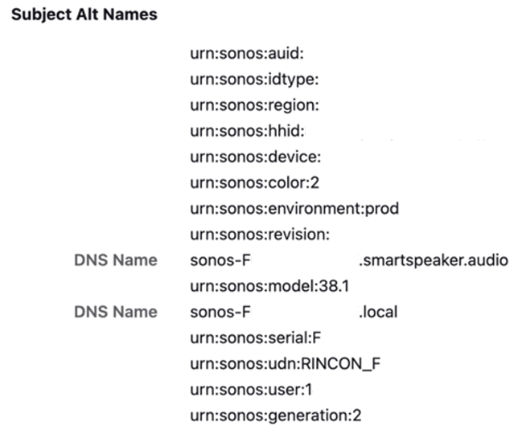

# About Sonos Model Numbers

This README explains how to find the model number used by Sonos S2 Devices when they download their firmware upgrades. 
It also maps the Desktop and Mobile Applications to their Model Numbers. 

By using the details described in this file, one can find a specific .upd version for their Sonos S2 Device. 
 
This can be helpful for backup and research purposes. 

## Desktop and Mobile Application Model Numbers

The following is the mapping between Model and Desktop/Mobile devices. 

- **Model 3** -> Windows Desktop Software
- **Model 4** -> macOS Desktop Software
- **Model 10 / 48** -> iOS Mobile Software
- **Model 11 / 47** -> Android Mobile Software

I am not clear why there are two different model numbers for the Mobile Applications. 

## The Model Number Is Not What It Seems

In order to download the firmware file for a Sonos Device, you need to know the model number. 
This seems easily enough to work out, but it is not straight-forward. 

The Sonos Era 100 is modern device, still being sold (as of October 2026). 
It's model number is `S39.` This is what the speaker reports right on the bottom label. 
This is also the model number reported in response to the API calls to the `device_description.xml` and `info` URLs. 

If you search all the manifest XML files in this repository, you will not find `S39`, `model="39"`, or `39` listed in the `model_list swgen="2"`. 

## Investigating a Firmware Download

To work this out, I triggered a software update of the Era 100 and snooped the URL that it used for the firmware file: 
`http://update-firmware.sonos.com/firmware/Prod/96.0-79160-v18.6-s8e6fwRJ0F-RC-3-SP1/96.0-79160-1-38.upd` 

Let's breakdown down this URL and look at the component pieces: 

| Section                              | Meaning            | Notes                                                                              |
| :----------------------------------- | :----------------- | :--------------------------------------------------------------------------------- |
| firmware                             | Firmware File      | This field can be `firmware` or `software`                                         |
| Prod                                 | Production Release | This field can be `Prod` or `Dev`                                                  |
| 96.0-79160-v18.6-s8e6fwRJ0F-RC-3-SP1 | Release Revision   | System: `96.0-79160`, App: `v18.6` `RC-3-SP1: Release Candidate 3, Service Pack 1  |
| 96.0-79160-1-38.upd                  | S39 Firmware       | 96.0-79160: `System Version`, 1-38: `Model Number`, upd: `update file`             |

Wait, the actual S38 is the `One SL (Gen 2)`, not the Era 100. 
Is this a shared code base? It's not. 

To get the ACTUAL model number, you have to pull it from the SAN (Subject Alternative Name) fields of the Player's certificate. 

 

From this SAN Field image, the Sonos Era's actual model number is `38.1`. 
This is stylized as `1-38` when downloading the firmware file. 

I have seen this same pattern across all my S2 devices. 
